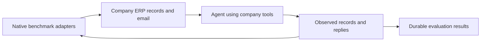

# The Agentic Company

A persistent simulated company for evaluating financial-operations support agents
through ordinary business tools: company email, ERPNext, documents, chat and
projects. It extends [The Agent Company](https://github.com/TheAgentCompany/TheAgentCompany)
with shared-company simulations, native benchmark adapters and durable results.

This is an independent project. Its company-adapted experiments and results are
separate from the original benchmarks’ leaderboards.

## How it works

One company stays available with its existing employees and records. A shared-company
experiment introduces a problem into that company; it does not create another
company or reset the environment. Multiple experiments can coexist, with separate
run IDs and evidence references, while sharing orders, invoices, stock and email.

- **Activity:** see tracked emails, messages, business actions and metrics.
- **Experiments:** browse business descriptions, inspect a task and run it.
- **Background providers:** independently start or stop CoffeeBench and
  E-CommerceBench. Stopping preserves their state; starting resumes it.
- **Results:** inspect saved evaluations, criteria, warnings and history for a run.
  Missing evidence, incomplete integration and evaluation failures remain explicit.

Viv works through normal company tools and communications. Benchmark runtimes,
private task criteria and evaluator credentials remain behind the coordinator.



ERPNext and delivered company email provide evidence of what happened. Adapters
translate supported actions back into native benchmark state and evaluators.
A draft, approval or email promise does not count as an executed payment,
refund or delivery. Unsupported mappings are reported rather than invented.

## Components

| Component | Role in this environment |
| --- | --- |
| The Agent Company workplace | Existing chat, ownCloud documents, projects and workplace assignments |
| ERPNext | Company customers, suppliers, orders, inventory, invoices and financial records |
| Mailu and midPoint | Employee inboxes, linked company identities and account management |
| Simulation coordinator and SimPy | Shared company time, event ordering, source mappings, durable state and evaluation |
| CoffeeBench | Pinned native business economy, counterparties and negotiations connected through company adapters |
| E-CommerceBench | Native market, supplier and transaction components mapped into company activity |
| τ-bench Retail | Original retail tasks and customer simulation adapted to company email and ERPNext |
| τ Airline, Banking and Telecom | External-provider cases with a case-bound employee portal and native provider-assistant evaluation |

The company identity, employee roster, departments and provider bindings come
from [company-identities.json](deploy/single-host/company-identities.json).
ownCloud access is department-based; the deployed policy links all 17 employees
and preserves existing documents and unmanaged shares.

CoffeeBench’s model-controlled business agents use the configured Codex CLI
connection, with the model selected in deployment configuration. E-Commerce’s background
market and disruption updates use deterministic rules. These environment actors
are separate from the agent under test. See the [actor runtime guide](deploy/enterprise-simulation/actors/README.md).

## Using the company

Open the configured company dashboard to view Activity, browse `/experiments`
and track `/runs`. Application addresses and employee accounts come from the
deployment configuration. Runtime credentials stay outside Git.

Each background provider has its own Start/Stop button. Stop preserves its saved
state. An operation already in flight can finish; the status shows **Stopping**
until it completes. Starting resumes the existing company activity rather than
resetting company data. See [background controls](docs/enterprise-simulation/background-controls.md).

Employee mail stays in company mailboxes. An explicitly configured external
recipient route connects the evaluated agent's inbox to company communications.

## Deployment and development

The project uses persistent application services, Docker Compose and isolated
Python environments. Configure service addresses, storage and resources for the
target deployment before starting the stack.

| Guide | Purpose |
| --- | --- |
| [Workplace deployment](deploy/single-host/README.md) | Application stack, persistent storage and service configuration |
| [Company email and identities](deploy/single-host/company-mail.md) | Mailu, employee accounts, smtp4dev routing and midPoint |
| [ERPNext runtime](docs/enterprise-simulation/erpnext-runtime.md) | Existing company site, roles and native integration evidence |
| [Coordinator deployment](deploy/enterprise-simulation/coordinator/README.md) | Private configuration, bootstrap, service operations and persistence |
| [Actor workers](deploy/enterprise-simulation/actors/README.md) | Pinned upstream runtimes, isolated environments and Codex transport |
| [Dashboard operation](docs/enterprise-simulation/company-dashboard.md) | Shared-company experiment and activity flow |
| [Identity/email delivery contracts](servers/company/README.md) | Durable mail/chat delivery, ownCloud source references and retries |

Back up databases, private evidence and configuration before updating services.
A code rollback must not overwrite newer company activity. Provider Start/Stop
controls do not reset company data.

For the React/shadcn dashboard:

```sh
npm --prefix servers/experiments/web ci
npm --prefix servers/experiments/web run build
```

From a coordinator development environment with its dependencies installed,
focused integration checks include:

```sh
python -m pytest servers/simulation/tests/test_company_background.py \
  servers/experiments/tests/test_app.py servers/experiments/tests/test_coordinator.py
```

Keep the native actor dependency environments separate; use their committed
locks and deployment guides. Integration checks use synthetic evidence and
controlled transports. Do not launch experiments, live benchmark episodes,
judging or Viv work as an infrastructure smoke test.

## Evaluation and coverage

Results are append-only records in the coordinator SQLite database. Each retains
its evaluation ID, company/run/generation, source version, evidence reference and
hash, native-scale scores, criterion results, warnings and safe failure details.
Private evidence is stored separately. Idempotent retries return the saved
attempt rather than judging again.

Scores retain their original scales; there is no combined percentage across
benchmarks. Native provider-assistant scores are not Viv performance scores.
Company-adapted evaluations are labelled, and shared-record interactions can make
attribution inconclusive. See [evaluation history](docs/enterprise-simulation/evaluation-history.md),
[results UI](docs/experiments-results.md) and [feedback contracts](docs/enterprise-simulation/company-feedback.md).

Current coverage includes 114 Retail definitions and 2,432 external-provider
cases: 50 Airline, 97 Banking and 2,285 Telecom. These are source catalogue
counts, not completed experiments. Eight Retail definitions have references our
importer cannot match in the pinned source data. All 200 Intake cases are
explicitly deferred. GitLab employee identity work and coding-task support are
outside the current scope.

Deployment health, native service boundaries and controlled integration checks
do not establish a successful live benchmark episode or agent performance.
The latest integration/control verification did not run experiments or test Viv.
Historical workplace smoke tests are recorded separately. For requirement coverage,
exact checks and remaining limits, see [requirements](docs/enterprise-simulation/requirements.md)
and [integration verification](docs/enterprise-simulation/verification.md).

[Security scanning](docs/security-scanning.md) covers dependency vulnerabilities
and secret detection through public GitHub Actions and Dependabot.

## Upstream projects and licensing

The workplace foundation is The Agent Company. Its original setup and benchmark
harness remain documented in [server setup](docs/SETUP.md),
[task images](workspaces/README.md) and [evaluation](docs/EVALUATION.md).
The unused OpenHands baseline runner has been removed. Original benchmark workflows are
separate from shared-company experiments and can include destructive resets.

The repository retains its [MIT license](LICENSE) and upstream attribution.
Vendored components retain their own licenses, including
[CoffeeBench](third_party/coffeebench/LICENSE),
[E-CommerceBench](third_party/ecommercebench/LICENSE) and
[τ-bench](servers/simulation/tau2_actor_runtime/TAU2-LICENSE.txt).
Pinned revisions and integration boundaries are documented in the
[upstream catalogue audit](docs/enterprise-simulation/upstream-catalogue-audit.md).

Contributions should target [The Agentic Company](https://github.com/askviv/TheAgenticCompany/pulls).
Changes proposed to upstream projects are separate contributions.

Original The Agent Company citation:

```
@misc{xu2024theagentcompanybenchmarkingllmagents,
      title={TheAgentCompany: Benchmarking LLM Agents on Consequential Real World Tasks}, 
      author={Frank F. Xu and Yufan Song and Boxuan Li and Yuxuan Tang and Kritanjali Jain and Mengxue Bao and Zora Z. Wang and Xuhui Zhou and Zhitong Guo and Murong Cao and Mingyang Yang and Hao Yang Lu and Amaad Martin and Zhe Su and Leander Maben and Raj Mehta and Wayne Chi and Lawrence Jang and Yiqing Xie and Shuyan Zhou and Graham Neubig},
      year={2024},
      eprint={2412.14161},
      archivePrefix={arXiv},
      primaryClass={cs.CL},
      url={https://arxiv.org/abs/2412.14161}, 
}
```
