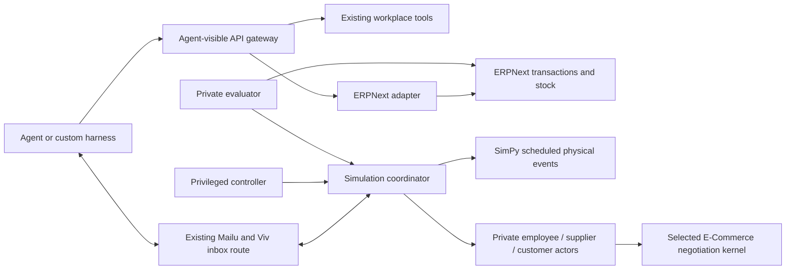

# Enterprise simulation extension

This extension is based on the [supplied specification](specification.md). The existing
company email deployment is the communication boundary: Mailu stores employee and
counterparty inboxes; the exact Viv recipient route reaches the existing smtp4dev
inbox. Do not introduce another mail service or a dashboard channel selector.

## Compatibility audit, completed before implementation

- [ERPNext/Frappe and official deployment](erpnext-compatibility.md)
- [CoffeeBench and E-Commerce Bench](business-simulators-compatibility.md)
- [Official SimPy and tau2-bench](time-customer-compatibility.md)
- [Requirement-to-implementation traceability](requirements.md)

The workplace baseline is `bbdda096e8d5e81ccdacf5cbcb12891b1bf9dbf2` on
`main`; upstream HEAD reviewed is
`98b68ef82a47690c316f42fddb05baafaab56851`. The existing workplace uses Python
3.12–3.13, Flask, requests, IMAPClient and SQLite. Its full benchmark/OpenHands
lock should not become the new services' runtime environment.

The ERPNext 16.53 image (Frappe 16.54 at runtime) requires Python 3.14 and therefore belongs in its own official
container stack, accessed over permission-checked APIs. SimPy 4.1.2 was imported
and its equal-time ordering exercised on Python 3.12. Tau2's Python range matches
the workplace, but its base dependencies remain broad. Neither business benchmark
provides an ERP or Mailu adapter; their private ledgers must not become company
financial truth. The reports distinguish concrete source candidates, conceptual
reuse, required adapters, and runtime proof still needed.

## Ownership and dependency map

The gateway exposes only permitted business observations/actions. Clock control,
pending events, actor-private records, reset credentials, and expected answers are
controller/evaluator facilities. The agent never receives the timeline or hidden
shipment location simply because it can read a case.

Mail is an observation and communication channel, not proof of financial approval.
A message claiming a payment happened cannot change ERP state. Approval records
must originate from an authenticated authorized decision, reference the exact
transaction/version, and be checked when a consequential action is attempted.

## Implementation boundaries

- `simulation-coordinator`: canonical run/entity IDs, private state, append-only
  audit, idempotency, actor visibility, durable outbox, reset/replay and evaluation.
- `erpnext-adapter`: native document/workflow operations under dedicated ERP roles;
  ERPNext remains authoritative. Draft review requests do not imply submission or
  payment. Financial posting requires authorization as the specification states.
- `simulation-clock`: case SimPy ordering is controller-driven; the company
  background service follows the shared real-time company clock. Persist event
  definitions/receipts and native Coffee checkpoints, not wall-clock sleeps.
- External actors: the company background executes the pinned CoffeeBench native
  economy and selectively uses E-CommerceBench's dated external supplier-market
  signals. Supplier dispatch beliefs and buyer receipts remain separate records;
  Coffee source documents are reconciled into native ERPNext, while E-Commerce
  emits no synthetic AP. See [background operator details](company-background-finance.md).
- Customer domain: isolated upstream τ-bench `Task`/`UserSimulator` and action /
  communication evaluators, with private customer facts and Mailu turn delivery.
  A Codex CLI LiteLLM provider adapter returns model text/tool-call data to the
  upstream simulator; no live inference or agent performance run is claimed.
- Mail adapter: reuse Mailu SMTP/IMAP, actual employee identities and durable receipt
  confirmation. Correlate run/generation and thread IDs; retries reconcile receipts.

Reset operates on a run's owned ERP site/snapshot and coordinator generation. It
must not call the existing global workplace reset endpoints or erase shared mail.
Separate runs retain independent IDs and audit histories. Agent-readable services
must not mount controller databases, evaluator fixtures, credentials or Docker sockets.

## Delivered implementation

The coordinator, native ERP adapter, SimPy event scheduler, private business and customer actors, approval policy, durable mail integration and independent evaluator are implemented. Deployment uses the existing company mail and workplace services; it adds no new mail stack or VM. See [integration verification](verification.md), [implementation review](implementation-review.md), [ERP runtime](erpnext-runtime.md) and [operator/deployment guide](../../deploy/enterprise-simulation/coordinator/README.md).

The existing chat, files and projects remain workplace tools; no new connector to those applications is introduced. Company communication for this extension uses the existing email and controlled API. The full pinned CoffeeBench native economy, selective E-CommerceBench source signals, and τ-bench customer turn/evaluation APIs run in isolated runtimes. The τ Retail source catalogue contains 114 tasks; this is not evidence of completed task runs. The Codex CLI transport uses the configured existing ChatGPT account. A neutral transport probe returned one response from the configured model; it did not invoke an actor prompt or include a simulated conversation. Component tests mock the transport. No Viv performance, live background actor run, full benchmark suite, or scenario outcome is claimed. No payment/refund execution tool is exposed.

A1–E1 integration fixtures and the optional S01 driver are provided for later use. This handover is integration documentation and component verification only: no business scenario, Viv task or autonomous performance experiment is run. The neutral transport probe is not an actor or benchmark run. Scenario model usage/costs and human interventions are unmeasured; report metrics distinguish tested-agent usage from environment actors and mark unknown costs unavailable rather than zero. Original benchmark instructions and scoring remain unchanged.

Runtime configuration, actor credentials, evaluator state and full private trajectories stay on the host outside Git. The agent-only client configuration allows a custom harness to use the same environment without rebuilding it. Start with one active assignment on this hardware; distinct runs are isolated, but concurrent capacity is not measured.
